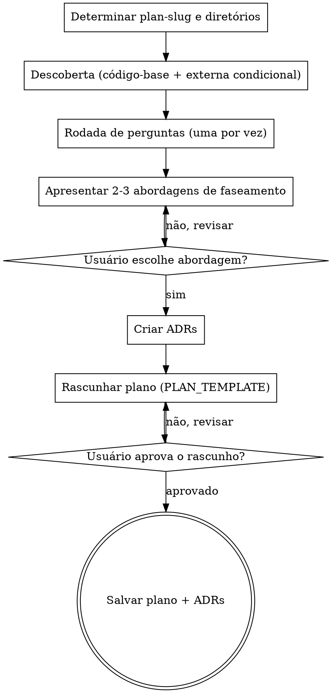

# Document Plan

Cria e mantém `.plans/<plan-slug>/README.md` — a única fonte de verdade do plano de implementação — e os ADRs que justificam suas decisões em `.plans/<plan-slug>/adrs/`. Tudo fica dentro de uma única pasta, assim como `.specs/<name>/`.

É a via **rápida** do fluxo spec-driven: onde o caminho longo produz PRD, TechSpec e arquivos de task separados, aqui um único documento faseado cumpre o papel — mantendo o mesmo rigor de descoberta, perguntas e registro de decisões.

Funciona em qualquer repositório, linguagem ou layout Git. Os comandos concretos do projeto (testes, lint, build) não estão nesta skill: eles são descobertos na Fase de descoberta e registrados na seção **Comandos do Projeto** do plano, que é o que os executores consomem.

<HARD-GATE>
NÃO escreva o arquivo do plano até que a descoberta, a rodada de perguntas e a escolha da abordagem de faseamento estejam concluídas e o usuário tenha aprovado o rascunho.
NÃO pule a exploração do código-base — todo plano DEVE ser ancorado em caminhos e símbolos reais do repositório.
NÃO pule as perguntas — o usuário DEVE participar de cada ponto de decisão.
NÃO gere um plano sem ao menos um ADR registrando a abordagem escolhida e as alternativas rejeitadas.
NÃO exija aprovação seção por seção — gere o rascunho completo e deixe o usuário revisá-lo.
Isso se aplica a TODO plano, independentemente da simplicidade percebida.
</HARD-GATE>

## Quick start

```
/document-plan <feature-name>           # descoberta → perguntas → abordagem → ADRs → plano
/document-plan <feature-name> --update  # relê o código e atualiza status, checklists, log e ADRs
```

## Como fazer perguntas

Quando esta skill instruir você a fazer uma pergunta, você DEVE usar a ferramenta interativa de perguntas do seu runtime — a que apresenta a pergunta e **pausa a execução até o usuário responder**. Não emita perguntas como texto comum e continue gerando.

Se o runtime não fornecer tal ferramenta, apresente a pergunta como sua mensagem completa e pare de gerar. Não responda à sua própria pergunta nem prossiga sem a entrada do usuário.

Protocolo completo em `references/question-protocol.md`.

## Antipadrão: "Este trabalho é simples demais para uma rodada de perguntas"

Todo plano passa pela rodada de perguntas. Um bugfix pontual, um ajuste de config, uma migração de três arquivos — todos. Trabalho "simples" é onde premissas não examinadas sobre o código existente viram retrabalho. A rodada pode ser curta (3 perguntas) para trabalhos genuinamente simples, mas ela DEVE acontecer.

## Antipadrão: Plano genérico

Um plano cujas tasks poderiam ter sido escritas sem abrir o repositório é um plano inútil. Cada task deve citar **caminhos reais**, **símbolos reais** e um **comando de validação executável**. Se você não conseguiu localizar o arquivo que a task vai alterar, você ainda não terminou a descoberta.

## Antipadrão: Validação vaga

`"testar manualmente"`, `"verificar se funciona"`, `"rodar os testes"` não são critérios de validação. Escreva o comando exato do projeto e o sinal observável esperado — `<comando de teste> <escopo>` → 0 falhas; `<requisição> <rota>` → 200 sem erro no log; `<símbolo antigo>` sem ocorrências no código.

---

## Workflow 1 — Criar plano (sem `--update`)

### Passo 1 — Determinar slug e diretório

- Derive o `plan-slug` do nome da feature: `YYYYMMDD-<kebab-case>` com a data de hoje (ex.: `20260817-otimizar-pipeline-ci`).
  - Se o usuário fornecer explicitamente um slug sem data, respeite-o.
  - Se `.plans/<plan-slug>/` já existir, leia `.plans/<plan-slug>/README.md` e **opere em modo de atualização** (Workflow 2), avisando o usuário.
- Crie a pasta `.plans/<plan-slug>/`.
- O plano vai em `.plans/<plan-slug>/README.md`.
- Os ADRs vão em `.plans/<plan-slug>/adrs/adr-NNN.md`. Crie a pasta `adrs/` se não existir.

### Passo 2 — Descoberta

**Trilha A — Exploração do código-base (OBRIGATÓRIA).**

- Localize os arquivos, símbolos, testes e pontos de integração que o trabalho vai tocar.
- Leia os arquivos de convenção do repositório antes de propor qualquer alteração: `AGENTS.md` / `CLAUDE.md` / `CONTRIBUTING.md` da raiz **e** o de cada módulo, pacote ou diretório afetado, quando existirem. Regras locais têm precedência sobre as da raiz.
- Identifique o(s) `git_root` envolvido(s) — isso decide o faseamento e o paralelismo depois.
- **Descubra os comandos reais do projeto** (testes, lint, verificação de tipos/build, subir o app) lendo o arquivo de scripts, Makefile, config de CI ou docs de contribuição. Eles alimentam a seção **Comandos do Projeto** do plano e toda coluna `Validação`. Nunca presuma o comando por convenção da linguagem — confirme no repositório.
- Rode comandos de mapeamento reais (busca por texto, listagem de diretórios, inspeção de histórico) e guarde os que forem úteis para o Repository Map.
- Resuma em 3-6 bullets: o que existe hoje, onde está e o que está quebrado/faltando.

**Trilha B — Pesquisa externa (CONDICIONAL).**

Execute apenas quando o trabalho depender de uma API, biblioteca, serviço ou comportamento de plataforma **externo**, cujo contrato você não consegue ler no repositório. Nesse caso faça 2-4 buscas e resuma em bullets. Caso contrário, declare "sem pesquisa externa necessária" e siga.

Execute as trilhas aplicáveis **em paralelo**. Apresente ao usuário um resumo combinado e curto antes de perguntar qualquer coisa.

### Passo 3 — Rodada de perguntas

Siga `references/question-protocol.md`. Regras não negociáveis:

- **Uma pergunta por mensagem.** Sua mensagem deve conter exatamente um ponto de interrogação. Depois de perguntar, PARE.
- **Múltipla escolha sempre que as opções puderem ser predeterminadas** (A/B/C), com fallback `D) Outro — descreva`. Use a descoberta do Passo 2 para que as opções sejam concretas, não genéricas.
- **Pule o que já foi respondido.** Se o usuário já deu a informação na conversa, não pergunte de novo — confirme apenas o que ficou ambíguo.
- Faça de 3 a 8 perguntas, cobrindo obrigatoriamente estas dimensões (uma por vez):

  1. **Propósito e resultado observável** — que problema resolve e como se sabe que acabou.
  2. **Escopo e não-escopo** — o que fica de fora nesta rodada.
  3. **Faseamento** — como o trabalho se divide e o que precisa vir antes do quê.
  4. **Invariants** — o que não pode quebrar (contratos de API, dados, comportamento em produção, feature flags).
  5. **Validação** — qual comando/sinal prova cada fase; o que só dá para validar manualmente.
  6. **Git e branch** — qual `git_root`, qual `base_branch`, feature branch ou stacked, auto-commit ou não.
  7. **Paralelismo** — quais fases poderiam rodar em paralelo sem colidir (entrada direta para o `plan-orchestrator`).
  8. **Risco/reversão** — quando aplicável: como reverter, o que fazer se a fase falhar em produção.

- Conclua a rodada inteira antes de apresentar abordagens.

### Passo 4 — Abordagens de faseamento e ADRs

- Apresente **2-3 abordagens distintas de faseamento/estratégia técnica**, com trade-offs explícitos. Elas devem diferir de forma significativa (ordem das fases, granularidade, incremental vs. big-bang, migração vs. reescrita), não em detalhes cosméticos.
- Comece pela recomendada e diga por quê.
- Aguarde o usuário escolher.
- **Crie um ADR para a abordagem escolhida:**
  - Leia `references/adr-template.md`.
  - Numere olhando os arquivos existentes em `.plans/<plan-slug>/adrs/` (3 dígitos com zeros à esquerda: `adr-001.md`).
  - Preencha: abordagem escolhida em **Decisão**; abordagens rejeitadas em **Alternativas Consideradas** com prós/contras e "Por que rejeitada"; trade-offs em **Consequências**. Status `Aceito`, Data = hoje.
  - Em **Referências**, aponte para `.plans/<plan-slug>/README.md`.
- **Crie ADRs adicionais** para cada decisão técnica significativa fechada durante a rodada de perguntas: escolha de tecnologia/biblioteca, mudança de contrato, estratégia de migração de dados, decisão de compatibilidade retroativa, corte de escopo relevante. Uma decisão é significativa se um agente futuro poderia razoavelmente questioná-la.
- **Mínimo obrigatório: 1 ADR.** Se você chegou ao Passo 5 sem nenhum ADR, volte e registre ao menos a abordagem principal.

### Passo 5 — Rascunhar o plano

Use `templates/PLAN_TEMPLATE.md` como base. Regras de preenchimento:

- **Header** — `Status: Planning`, `Current Phase: Phase 1 — <nome>`, `Last Updated` = hoje, `Resume Point` apontando para a Task 01 com uma linha de contexto útil.
- **Invariants** — derivados das respostas e da descoberta, não genéricos. Inclua também as regras de higiene que o repositório declara nos seus arquivos de convenção (ex.: proibição de código morto); se ele não declarar nenhuma, mantenha ao menos a de não deixar símbolos órfãos.
- **Repository Map & Discovery** — uma linha por área tocada, com caminho real e o comando/observação que a mapeia.
- **Phase Outline** — cada fase com objetivo, **dependências de fase**, `git_root` e Definition of Done observável. As colunas `Depende de` e `Git root` são o insumo direto do `plan-orchestrator`; nunca as deixe vazias.
- **Master Task List** — fases viradas em tasks numeradas (`01`, `02`, …). Cada task tem Fase, Status `[ ]`, complexidade (`S`/`M`/`L`), Deps e **Validação executável**. Toda task pertence a exatamente uma fase.
- **Comandos do Projeto** — preencha com os comandos reais descobertos no Passo 2. É a única fonte de comandos para os executores; deixá-la vaga força cada agente a adivinhar.
- **Architecture Decision Records** — liste cada ADR criado com número, título, resumo de uma linha e link relativo para `<plan-slug>/adrs/adr-NNN.md`.
- **Checklists por Fase** — passos detalhados por fase, abaixo da Master Task List.
- **Progress Log** — comece com a `Iteração 0 — Setup`, resumindo as decisões fechadas com o usuário.
- **Deferred / Blocked** — registre aqui tudo que foi cortado por YAGNI e por quê. Isso evita que um agente futuro "redescubra" a ideia descartada.
- **Notes for Future Agents** — pegadinhas do código, convenções locais do módulo, comandos que não funcionam neste ambiente, credenciais ou acessos necessários.

Aplique YAGNI sem dó: toda fase que não é necessária para o resultado observável vai para Deferred.

Idioma: **Português do Brasil (pt-BR)**, exceto termos técnicos, caminhos e comandos.

### Passo 6 — Revisar com o usuário

Apresente o rascunho completo e pergunte, usando a ferramenta interativa:

- A) Aprovado — salvar como está
- B) Ajustar fases/tasks específicas (diga quais)
- C) Reescrever a seção X (diga o que mudar)
- D) Descartar e recomeçar

Se B ou C: aplique e reapresente. Se D: volte ao Passo 3.

### Passo 7 — Salvar

- Crie a pasta `.plans/<plan-slug>/` se não existir.
- Grave o plano em `.plans/<plan-slug>/README.md`.
- Grave os ADRs em `.plans/<plan-slug>/adrs/adr-NNN.md`.
- Confirme os caminhos ao usuário e informe o próximo passo:
  - execução fase a fase, com você no controle → `/execute-phase-plan .plans/<plan-slug>/README.md <fase>`
  - execução completa em ondas paralelas → `/plan-orchestrator .plans/<plan-slug>/README.md`

---

## Workflow 2 — Atualizar plano (`--update`)

1. **Leitura** — leia `.plans/<plan-slug>/README.md` inteiro e os ADRs em `.plans/<plan-slug>/adrs/`.
2. **Verificação de evidências** — para cada task não concluída, procure no código a prova de implementação: arquivo, export, rota, teste, entrada de config. **Nunca** marque `[x]` por relato: só com evidência verificável. Detalhes em `references/update-protocol.md`.
3. **Atualização de status** — `[ ]` pendente → `[~]` em progresso → `[x]` concluído. Atualize também o status da fase no Phase Outline e os checklists.
4. **Header** — atualize `Status`, `Current Phase`, `Last Updated` e reescreva o `Resume Point` para a próxima task pendente, com contexto suficiente para um agente sem histórico continuar.
5. **Progress Log** — adicione uma nova entrada (branch, resumo, arquivos, evidência de validação). **Nunca remova nem reescreva entradas anteriores.**
6. **ADRs** — se a execução mudou uma decisão registrada, **não edite o ADR antigo**: crie um novo ADR com Status `Aceito`, marque o antigo como `Substituído por ADR-NNN`, e atualize a seção Architecture Decision Records do plano. Decisões novas tomadas durante a execução também viram ADR.
7. **Deferred / Blocked** — registre impedimentos encontrados, com motivo e por quem/o quê está bloqueado.
8. **Divergências** — se o código implementado divergir do que a task descrevia, atualize o texto da task para refletir a realidade e registre a divergência no Progress Log.

---

## Fluxo do processo



---

## Tratamento de erros

- Contexto insuficiente para uma seção → registre em **Deferred / Blocked** ou em uma pergunta aberta no plano, em vez de adivinhar.
- Ferramentas de busca na web indisponíveis → prossiga só com o código-base e registre a limitação em **Notes for Future Agents**.
- `.plans/` ou `.plans/<plan-slug>/` inexistente → crie.
- Plano já existente em `.plans/<plan-slug>/README.md` sem `--update` → avise e opere em modo de atualização; nunca sobrescreva um plano com progresso.
- Fases com dependência cíclica → aponte o ciclo ao usuário e peça o desempate antes de salvar.

---

## Princípios-chave

- **Arquivo único** — `.plans/<plan-slug>/README.md` é a única fonte de verdade do progresso; os ADRs em `.plans/<plan-slug>/adrs/` são a fonte de verdade das decisões.
- **Uma pergunta por vez** — nunca empilhe perguntas numa mesma mensagem.
- **Múltipla escolha obrigatória** quando as opções puderem ser predeterminadas.
- **Ancorado no repositório** — caminhos, símbolos e comandos reais; nada genérico.
- **Validação executável** — nenhuma task sem um sinal observável de conclusão.
- **ADR obrigatório** — no mínimo um, registrando a abordagem e o que foi rejeitado.
- **Sem evidência, sem `[x]`** — status só avança com prova no código.
- **YAGNI sem dó** — o que não serve ao resultado observável vai para Deferred.
- **Faseamento executável** — `Depende de` e `Git root` preenchidos em toda fase; é o contrato com o `plan-orchestrator`.
- **Idioma** — pt-BR, exceto termos técnicos e comandos.

## Skills relacionadas

| Skill | Quando |
|-------|--------|
| `execute-phase-plan` | Executar **uma** fase do plano e atualizá-lo em seguida |
| `plan-orchestrator` | Executar o plano **inteiro** em ondas paralelas com worktrees |
| `execute-orchestrated-plan-phase` | Worker do `plan-orchestrator` — não invoque manualmente |
| `create-prd` | Quando o trabalho precisa de requisitos de produto, não de um plano técnico (se instalada) |
