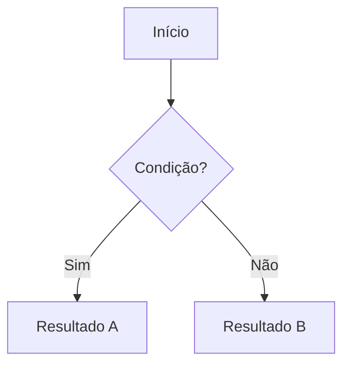
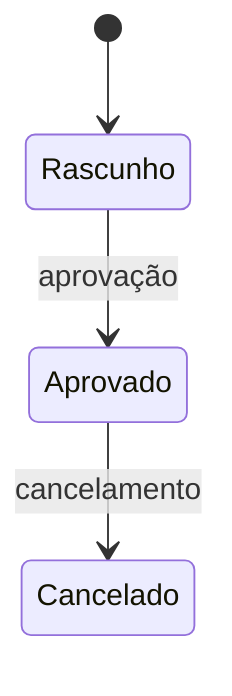

# Template — Documento de Regra de Negócio

> Preencha cada seção em pt-BR, em linguagem de domínio neutra. Remova seções que não se apliquem (registre o motivo em "Premissas"). NUNCA inclua código, frameworks, arquivos, nomes técnicos ou padrões de implementação. Toda regra deve ser numerada (RN-NNN), rastreável e verificável.

---

# Regra de Negócio: <Nome da Feature>

## 1. Visão Geral

Resumo de 3-6 linhas: que problema de negócio esta feature resolve, qual valor entrega e em que contexto é usada. Independente de tecnologia.

## 2. Glossário

Termos de domínio usados no documento, com definição objetiva.

| Termo | Definição |
| --- | --- |
| <termo> | <definição neutra de negócio> |

## 3. Atores e Papéis

Quem interage com a feature e qual o objetivo de cada um.

| Ator | Objetivo | Permissões/Restrições relevantes |
| --- | --- | --- |
| <ator> | <o que busca> | <o que pode/não pode fazer> |

## 4. Regras de Negócio

Afirmações verificáveis no formato condição → resultado. Numere sequencialmente.

| ID | Regra | Racional (por que existe) |
| --- | --- | --- |
| RN-001 | <quando [condição], então [resultado esperado]> | <motivo de negócio> |
| RN-002 | … | … |

> Detalhe regras complexas em subtópicos abaixo da tabela quando necessário, sempre referenciando o ID.

## 5. Invariantes de Negócio

Condições que devem permanecer verdadeiras em qualquer cenário (inclusive erro, reprocesso ou operação manual).

| ID | Invariante | Regras relacionadas |
| --- | --- | --- |
| INV-001 | <condição que nunca pode ser violada> | RN-00X, RN-00Y |

## 6. Fluxos de Processo

Descreva os fluxos principais do ponto de vista do negócio/usuário. Referencie as regras aplicáveis (RN-NNN) em cada passo relevante. Use Mermaid quando ajudar.

### 6.1 Fluxo: <nome do fluxo>

1. <passo> (aplica RN-001)
2. <passo>
3. <passo>

## 7. Estados e Transições

Inclua somente se a feature tiver ciclo de vida/máquina de estados.

| Estado | Significado | Transições permitidas | Gatilho |
| --- | --- | --- | --- |
| <estado> | <o que representa> | <para quais estados> | <o que dispara> |

## 8. Validações e Restrições

O que é exigido, proibido ou limitado, e o porquê. Conceitual, sem formatos técnicos.

| ID | Campo/Conceito | Regra de validação | Mensagem/Comportamento esperado | Racional |
| --- | --- | --- | --- | --- |
| VAL-001 | <conceito> | <obrigatório / limite / formato lógico> | <o que ocorre quando inválido> | <motivo> |

## 9. Cálculos e Fórmulas

Descreva cálculos de negócio conceitualmente: entradas, lógica e saída. Sem código.

- **<Nome do cálculo>**: a partir de <entradas>, aplica-se <lógica de negócio> para obter <saída>. Considerações: <arredondamento, limites, exceções>.

## 10. Casos de Borda e Exceções

O que acontece nos limites, em ausência de dados, conflitos e falhas de negócio.

| Cenário | Comportamento esperado | Regra relacionada |
| --- | --- | --- |
| <caso de borda> | <resultado esperado> | RN-NNN |

## 11. Critérios de Aceite (verificáveis)

Descreva cenários verificáveis em linguagem natural, sem tecnologia.

| ID | Cenário | Dado | Quando | Então | Regras relacionadas |
| --- | --- | --- | --- | --- | --- |
| CA-001 | <nome do cenário> | <contexto inicial> | <evento> | <resultado esperado> | RN-00X |

## 12. Decisões para Migração

Classifique as regras para facilitar portabilidade em outro sistema.

| Item | Classificação | Justificativa |
| --- | --- | --- |
| <RN-00X ou regra resumida> | Obrigatório preservar / Configurável / Dependente de contexto local | <motivo de negócio> |

## 13. Dados de Domínio (Conceitual)

Entidades conceituais e seus atributos de negócio (não é schema técnico). Inclua apenas o que é relevante para entender as regras.

| Entidade | Atributos de negócio | Relacionamentos |
| --- | --- | --- |
| <entidade> | <atributos> | <com quais entidades se relaciona> |

## 14. Premissas

Suposições assumidas durante a extração (inclusive regras inferidas do código e ainda não confirmadas).

- <premissa>

## 15. Questões em Aberto

Pontos que precisam de decisão ou confirmação antes de aplicar em outro sistema.

- <questão>
